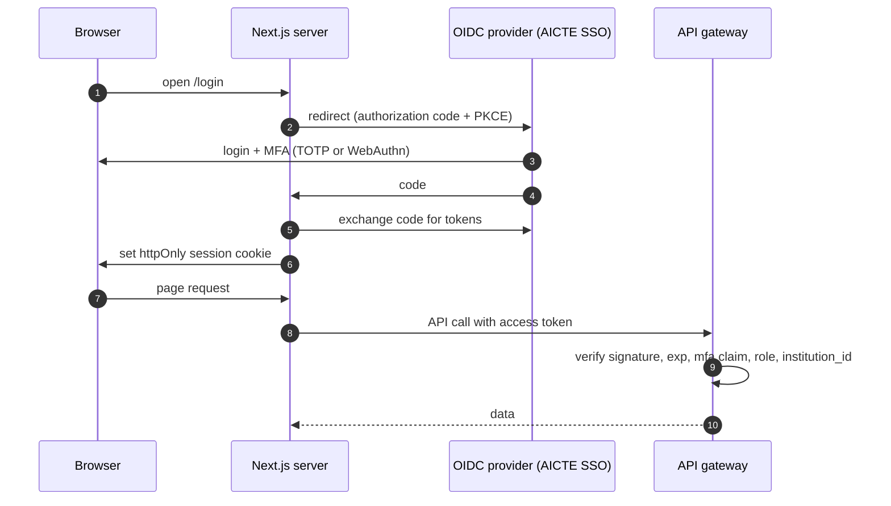
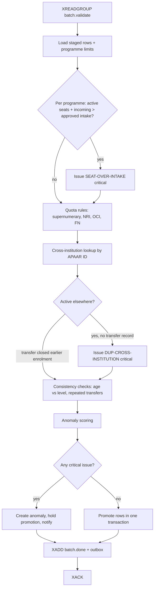
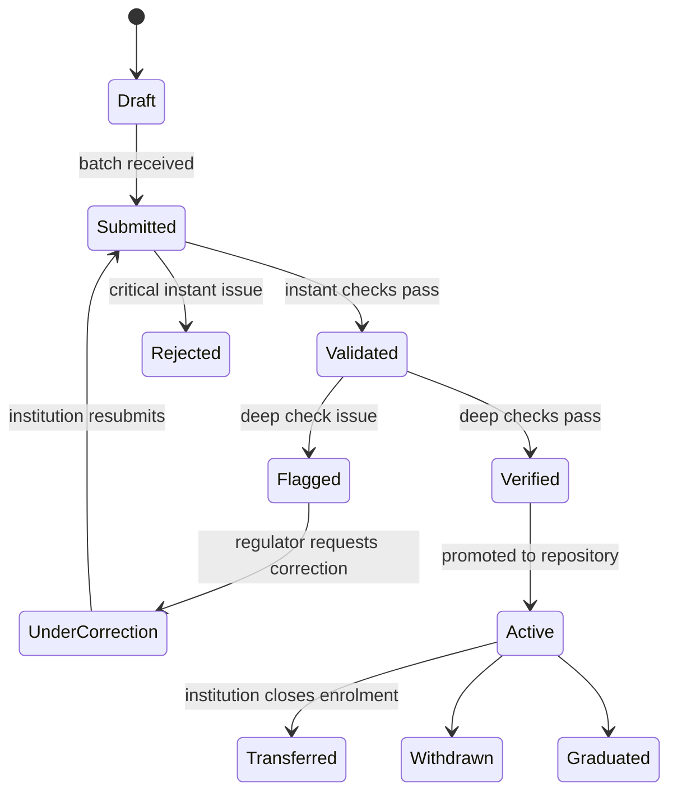
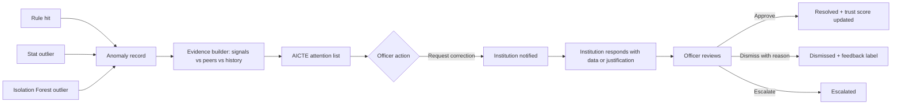
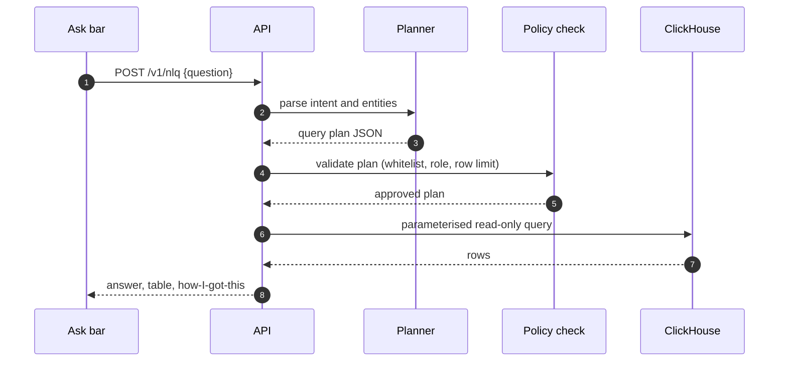
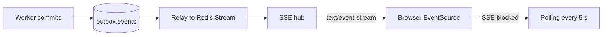
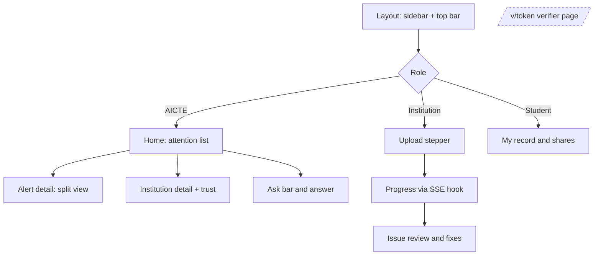
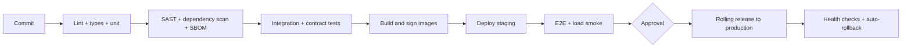

# APAAR Setu — Deep Technical Flow (Backend + Frontend)

Developer reference for how every request, event, and state change moves through APAAR Setu. Pair with `ARCHITECTURE.md` (structure) and `PRD.md` (requirements). Diagrams use Mermaid; paste into any Mermaid viewer if your editor does not render them.

---

## 0. Conventions

| Item | Convention |
|---|---|
| API | REST/JSON, `/v1`, OpenAPI 3.1, errors as RFC 9457 problem+json |
| IDs | UUIDv7 for internal rows; APAAR ID is the student key |
| Time | UTC ISO-8601 in API, stored `timestamptz` |
| Idempotency | `Idempotency-Key` header on all POSTs; row key `(apaar_id, institution_id, programme_id, year, cycle)` |
| Auth | `Authorization: Bearer <JWT>` (OIDC); claims: `sub`, `role`, `institution_id`, `mfa`, `exp` |
| Streams | `batch.validate`, `batch.done`, `anomaly.raised`, `outbox.events`, `dlq.*` |
| Correlation | `X-Request-Id` and OpenTelemetry `trace_id` propagated end to end |

---

## 1. Authentication and session flow



Rules
- Tokens never reach browser JavaScript; Next.js holds them in an httpOnly, SameSite=Strict cookie and calls the API server-side (BFF pattern).
- Access token 10 min, refresh rotation with reuse detection.
- Every authorisation decision is `role + attributes`: `institution_id == token.institution_id`, `field_sensitivity <= role.clearance`, `consent.scope ∋ claim`.
- Row-level security in PostgreSQL is a second wall: `SET app.institution_id = …` per request.
- Failure: 401 (no/expired token), 403 (role/attribute), 429 (rate limit). All three write an audit event.

---

## 2. Upload and ingestion flow (synchronous phase)

| Step | Component | Action | Writes | Failure handling |
|---|---|---|---|---|
| 1 | Gateway | Verify JWT, role `institution_*`, rate limit per institution | – | 401/403/429 |
| 2 | Ingest | Validate file type and size (≤ 200 MB, CSV/XLSX), virus scan | object store `uploads/{batch}` | 415/413 |
| 3 | Ingest | Create batch | `upload_batch(status=received)` | – |
| 4 | Ingest | Stream-parse in 1,000-row chunks | – | bad encoding → row error, not fatal |
| 5 | Ingest | Column mapping (saved per institution) | `column_map` | unmapped required → 422 with list |
| 6 | Validation (instant) | Schema, types, required fields, APAAR format + check digit, registry existence via adapter, date sanity, in-file duplicates | `staged_row`, `row_issue` | registry down → mark `pending_identity`, continue |
| 7 | Ingest | Publish job | Redis `XADD batch.validate {batch_id}` | Redis down → outbox row, retry |
| 8 | Ingest | Respond | `202 {batch_id, status_url, events_url}` | – |

Instant-check rules (all pure functions, unit-tested):
`APAAR-MISSING`, `APAAR-INVALID`, `APAAR-NOT-IN-REGISTRY`, `DUP-IN-FILE`, `FIELD-REQUIRED`, `DATE-INVALID`, `SEAT-TYPE-UNKNOWN`.

Response contract

```json
{
  "batch_id": "0193f…",
  "status": "received",
  "rows_total": 1240,
  "instant": {"passed": 1186, "flagged": 54},
  "events_url": "/v1/batches/0193f…/events"
}
```

---

## 3. Asynchronous deep validation (worker flow)

Workers read the stream with a consumer group (`XREADGROUP`), process one batch per message, and `XACK` only after the database transaction commits.



Details
- Over-intake counts Regular, NRI, OCI, FN active seats; supernumerary seats use their own cap. Parameters are read from `rule_param(year, rule_id)`, never hard-coded.
- Cross-institution lookup is an indexed query: `SELECT … FROM enrolment WHERE apaar_id = ANY($1) AND state='Active' AND institution_id <> $2`.
- Promotion is atomic: `INSERT … ON CONFLICT (row_key) DO UPDATE` creates a new version row, closes the previous (`valid_to = now()`), and writes `enrolment_event`.
- Retries: 3 attempts with exponential back-off; then message to `dlq.batch.validate` and an alert to admins. Idempotent by design, so a retry cannot duplicate rows.
- Backpressure: worker concurrency autoscales on stream lag (target lag < 2 min).

---

## 4. Enrolment lifecycle (state machine)



Every transition writes `enrolment_event(from, to, actor, reason, at)` and an audit entry.

---

## 5. Anomaly and correction workflow

Two triggers: event-driven (after each batch) and scheduled (nightly institution-level scoring).



ML job (nightly)
1. Build per-institution features: `fill_ratio, nri_share, supernumerary_share, spot_round_share, invalid_id_rate, duplicate_rate, correction_delay`.
2. Robust scale: `z = (x − median) / (1.4826 × MAD)`, clipped to ±12.
3. `IsolationForest(n_estimators=200, random_state=0)`; convert `score_samples` to 0–100 above the median.
4. Evidence: the three features with the largest positive `z`, each with value, peer median, and normalised weight.
5. Write `anomaly` rows for score ≥ 55; refresh `trust_score`.

Trust score = weighted sum: ID validity 25%, intake discipline 30%, identity integrity 20%, pattern normality 25% (+ correction responsiveness when history exists). Visible to AICTE roles only.

---

## 6. Natural-language query flow



Query plan (the only thing a model may produce)

```json
{"metric":"programmes_over_intake","filters":{"state":"Maharashtra","year":"2025-26"},"group_by":["institution"],"order":"ratio_desc","limit":10}
```

Safety: whitelisted metrics, dimensions, and filters; JSON-schema validation; parameterised SQL generated by our code; read-only DB user; 5 s timeout; 1,000-row cap; every question and plan audited. Ambiguity returns one clarifying question instead of guessing.

---

## 7. Credential issuance and verification

Diagram: see the chat sequence diagram. Contract summary below.

Issue
```http
POST /v1/credentials
{"claims":["programme","status"],"purpose":"Employment verification","days":7}
→ 201 {"token":"<payload>.<signature>","jti":"…","exp":1767225600}
```

Token payload (compact): `{"v":1,"iss":"did:web:apaarsetu.aicte.gov.in","jti":"…","iat":…,"exp":…,"c":{"programme":"B.Tech CSE","status":"Active"}}`; signature is Ed25519 over the base64url payload.

Verification rules (in order)
1. Parse token; reject malformed → `invalid`.
2. Verify signature with the issuer key (`kid` selects key) → else `invalid`.
3. If online: `jti` in revocation list → `revoked`.
4. `exp < now` → `expired`.
5. Else `valid` and return only the claims inside `c`.

Offline mode: steps 1, 2, 4 run on the device using the embedded public key; the screen states "checked offline" and the issue date.

Revocation: student `DELETE /v1/consents/{id}` adds `jti` to a compact status list; online verifiers see it immediately. Hash chain: `H(n) = SHA-256(H(n−1) ‖ canonical(entry))`; a periodic head hash is anchored off-system.

Abuse controls: per-IP and per-token rate limits, no enumeration (signed tokens only), CAPTCHA step-up on bulk patterns, every verification audited.

---

## 8. Real-time updates



- The outbox pattern guarantees no event is lost if Redis is down at commit time.
- SSE messages: `batch.progress`, `batch.done`, `anomaly.raised`, `correction.requested`. Each carries `id` for resume via `Last-Event-ID`.
- Clients auto-fall back to polling `GET /v1/batches/{id}` and `GET /v1/anomalies?since=…`.

---

## 9. Audit log flow

Each privileged or data-access action calls `audit.append(actor, action, object, digest)` inside the same DB transaction as the change:

```
entry_hash = SHA-256(prev_hash ‖ canonical_json({seq, at, actor, action, object, digest}))
```

- Append-only table; `UPDATE` and `DELETE` revoked at the database role level.
- `GET /v1/audit/verify` recomputes the chain and returns the first broken `seq`, if any.
- Head hash is published periodically to an external anchor; any rewrite breaks the chain.

---

## 10. Frontend flow (Next.js App Router)



| Concern | Approach |
|---|---|
| Rendering | Server Components for shells and lists; Client Components for interactive tables, stepper, SSE |
| Data | TanStack Query with keys per resource; mutation then targeted invalidation |
| Real time | `useEventStream(url)` hook: EventSource → query cache updates; auto-fallback to polling |
| Tables | TanStack Table + Virtual; server-side sort/filter/pagination for 100k+ rows |
| Upload | Chunked upload with progress, resumable by batch id; stepper state in URL |
| Auth | Server-side session; middleware guards routes by role; no tokens in client JS |
| i18n | `next-intl`; strings externalised; Indian number formatting by locale |
| Theme | CSS variables; light default, dark option, compact density saved per user |
| Errors | Error boundaries per route; specific messages and next actions |
| Verifier page | Static, under 100 KB, no login; verifies signature in-browser with WebCrypto; online call only for revocation |
| Accessibility | Keyboard-first, ARIA live regions for progress, axe-core in CI |

---

## 11. Failure and recovery matrix

| Failure | Detection | Behaviour | Recovery |
|---|---|---|---|
| APAAR registry down | adapter timeout | rows marked `pending_identity`, batch continues | retry queue, backfill when up |
| Redis down | enqueue error | write to outbox | relay drains outbox on recovery |
| Worker crash mid-batch | no `XACK`, idle pending entry | `XAUTOCLAIM` by another worker | idempotent reprocess |
| Poison message | 3 failed attempts | moved to `dlq.batch.validate` | admin review and replay |
| DB failover | connection errors | short retry, read replicas serve reads | automatic promotion, PITR as backup |
| Signing service down | health check | issuance paused, verification unaffected | HSM failover |
| SSE blocked | no events within 15 s | client polls | – |
| Duplicate upload | row key match | updates, not inserts | none needed |
| Bad column mapping | 422 on required field | stepper returns to mapping step | user fixes mapping |

---

## 12. Observability map

| Signal | Metric / event | Alert |
|---|---|---|
| Ingestion | `rows_ingested_total`, `instant_check_ms` | p95 > 1 s per 1,000 rows |
| Queue | `stream_lag_seconds`, `dlq_depth` | lag > 120 s, DLQ > 0 |
| Validation | `deep_check_ms`, `issues_by_rule` | spike × 3 vs 7-day median |
| Anomaly | `anomaly_open_total`, `ml_job_duration` | job failed |
| Verification | `verify_latency_ms`, `verify_result_total{result}` | p95 > 300 ms, invalid-rate spike |
| Security | `auth_fail_total`, `rate_limited_total`, `audit_chain_ok` | chain broken (page immediately) |
| Frontend | Web Vitals, SSE reconnects | LCP > 2.5 s |

---

## 13. Testing flow

| Level | What | Tool |
|---|---|---|
| Unit | rule functions, check digit, token sign/verify, hash chain | pytest |
| Property | rule engine never accepts invalid IDs; chain breaks on any edit | hypothesis |
| Integration | upload → worker → repository using real Postgres/Redis containers | pytest + testcontainers |
| Contract | OpenAPI schema vs responses | schemathesis |
| Load | 500k-row batch, 1,000 verify req/s | k6 |
| E2E | the four demo scenarios, mobile verifier | Playwright |
| Security | dependency and image scan, SAST, OWASP ZAP baseline | Trivy, Semgrep, ZAP |
| Accessibility | WCAG checks on every route | axe-core |

---

## 14. CI/CD flow



---

*End of document.*
